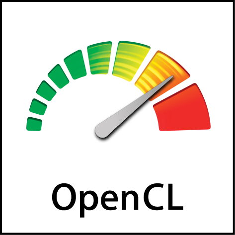

// Copyright 2019-2026 The Khronos Group. This work is licensed under a
// Creative Commons Attribution 4.0 International License; see
// http://creativecommons.org/licenses/by/4.0/

= The C++ for OpenCL 1.0 and 2021 Programming Language Documentation
:R: pass:q,r[^(R)^]
Khronos{R} OpenCL Working Group
:data-uri:
:icons: font
:toc2:
:toclevels: 4
:sectnums:
:sectnumlevels: 4
:max-width: 100
:numbered:
:imagewidth: 800
:fullimagewidth: width="800"
:source-highlighter: coderay
:title-logo-image: 

:blank: pass:[ +]
:cpp: pass:[C++]
:cpp14: pass:[C++17]

// Various special / math symbols. This is easier to edit with than Unicode.
include::config/attribs.adoc[]

<<<<

include::copyrights-ccby.adoc[]

// type of the source code in the document
:language: {basebackend@docbook:c++:cpp}

include::cxx4opencl/intro.adoc[]

<<<<

include::cxx4opencl/diff2cxx.adoc[]

<<<<

include::cxx4opencl/diff2openclc.adoc[]

<<<<

include::cxx4opencl/address_spaces.adoc[]

<<<<

include::cxx4opencl/cxxcasts.adoc[]

<<<

include::cxx4opencl/kernel.adoc[]

<<<

include::cxx4opencl/references.adoc[]

<<<

include::cxx4opencl/acknowledgements.adoc[]

