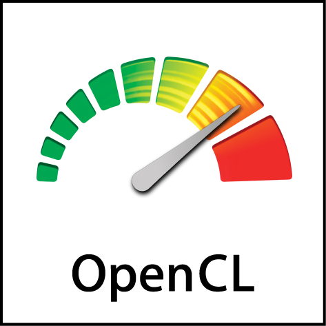

// Copyright 2017-2026 The Khronos Group
// SPDX-License-Identifier: CC-BY-4.0

// Extensions to enable
// Must be included before the header and attribs.adoc
include::{generated}/specattribs.adoc[]

= The OpenCL^(TM)^ Specification
:R: pass:q,r[^(R)^]
Khronos{R} OpenCL Working Group
:data-uri:
:icons: font
:toc2:
:toclevels: 3
:max-width: 100%
:numbered:
:imagewidth: 800
:fullimagewidth: width="800"
:source-highlighter: rouge
:source-language: opencl
:rouge-style: opencl.spec
:docinfo: shared-header
:docinfodir: config
:title-logo-image: 
:description: OpenCL(TM) is an open, royalty-free standard for cross-platform \
parallel programming of diverse accelerators. \
This document describes the OpenCL API.

// Various special / math symbols. This is easier to edit with than Unicode.
include::config/attribs.adoc[]

// Attributes that are shared by OpenCL specifications.
include::config/opencl.adoc[]

// Attributes for version notes, with local links.
include::config/version-local-links.adoc[]

// Formatting and links for API functions and enums.
include::api/dictionary.adoc[]

// Feature Dictionary.
include::c/feature-dictionary.adoc[]

// External Footnotes
include::api/footnotes.adoc[]

<<<<

include::copyrights.adoc[]

<<<

// :numbered:

:leveloffset: 1

include::api/introduction.adoc[]

include::api/glossary.adoc[]

include::api/opencl_architecture.adoc[]

include::api/opencl_platform_layer.adoc[]

include::api/opencl_runtime_layer.adoc[]

include::api/opencl_assoc_spec.adoc[]

include::api/embedded_profile.adoc[]

:numbered!:

include::api/appendix_a.adoc[]
include::api/appendix_b.adoc[]
include::api/appendix_c.adoc[]
include::api/appendix_d.adoc[]
include::api/appendix_e.adoc[]
include::api/appendix_f.adoc[]
include::api/appendix_g.adoc[]
include::api/appendix_h.adoc[]
include::api/appendix_extensions.adoc[]

<<<

include::api/acknowledgements.adoc[]
