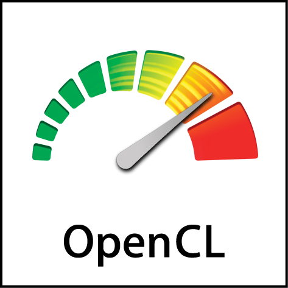

// Copyright 2017-2026 The Khronos Group. This work is licensed under a
// Creative Commons Attribution 4.0 International License; see
// http://creativecommons.org/licenses/by/4.0/

= The OpenCL^(TM)^ C++ 1.0 Specification
:R: pass:q,r[^(R)^]
Khronos{R} OpenCL Working Group
:data-uri:
:icons: font
:toc2:
:toclevels: 2
:max-width: 100
:numbered:
:imagewidth: 800
:fullimagewidth: width="800"
:source-highlighter: coderay
:title-logo-image: 

// type of the source code in the document
:language: c++

:numbered!:

// Various special / math symbols. This is easier to edit with than Unicode.
include::config/attribs.adoc[]

// Attributes that are shared by OpenCL specifications.
include::config/opencl.adoc[]

include::copyrights.adoc[]

<<<

:numbered:

// Generic Type Notation chapter
include::cxx/generic_type_name_notation.adoc[]

// Language chapter
include::cxx/lang/lang.adoc[]

include::cxx/lang/builtin_data_types.adoc[]

include::cxx/lang/keywords.adoc[]

include::cxx/lang/implicit_type_conversions.adoc[]

include::cxx/lang/expressions.adoc[]

include::cxx/lang/address_spaces.adoc[]

include::cxx/lang/kernel_functions.adoc[]

include::cxx/lang/preprocessor.adoc[]

include::cxx/lang/attribute_qualifiers.adoc[]

include::cxx/lang/restrictions.adoc[]

// Standard Library chapter
include::cxx/stdlib/stdlib.adoc[]

include::cxx/stdlib/definitions.adoc[]

include::cxx/stdlib/conversions.adoc[]

include::cxx/stdlib/reinterpreting_data.adoc[]

include::cxx/stdlib/address_spaces.adoc[]

include::cxx/stdlib/specialization_constants.adoc[]

include::cxx/stdlib/half_wrapper.adoc[]

include::cxx/stdlib/vector_wrapper.adoc[]

include::cxx/stdlib/range.adoc[]

include::cxx/stdlib/vector_utilities.adoc[]

include::cxx/stdlib/vector_iterator.adoc[]

include::cxx/stdlib/marker_types.adoc[]

include::cxx/stdlib/images_and_samplers.adoc[]

include::cxx/stdlib/pipes.adoc[]

include::cxx/stdlib/device_enqueue.adoc[]

include::cxx/stdlib/work_item.adoc[]

include::cxx/stdlib/work_group.adoc[]

include::cxx/stdlib/synchronization.adoc[]

include::cxx/stdlib/common.adoc[]

include::cxx/stdlib/geometric.adoc[]

include::cxx/stdlib/math.adoc[]

include::cxx/stdlib/integer.adoc[]

include::cxx/stdlib/relational.adoc[]

include::cxx/stdlib/vector_data_load_and_store.adoc[]

include::cxx/stdlib/printf.adoc[]

include::cxx/stdlib/atomic_operations.adoc[]

include::cxx/stdlib/array.adoc[]

include::cxx/stdlib/limits.adoc[]

include::cxx/stdlib/math_constants.adoc[]

include::cxx/stdlib/tuple.adoc[]

include::cxx/stdlib/type_traits.adoc[]

include::cxx/stdlib/iterator.adoc[]

include::cxx/stdlib/general_utilities.adoc[]

// Numerical Compliance chapter
include::cxx/numerical_compliance/numerical_compliance.adoc[]

include::cxx/numerical_compliance/rounding_modes.adoc[]

include::cxx/numerical_compliance/inf_nan_and_denormalized_numbers.adoc[]

include::cxx/numerical_compliance/floating_point_exceptions.adoc[]

include::cxx/numerical_compliance/relative_error_as_ulps.adoc[]

include::cxx/numerical_compliance/edge_case_behavior.adoc[]

// Image Addressing and Filtering chapter
include::cxx/image_addressing_and_filtering.adoc[]

// Compiler Options chapter
include::cxx/compiler_options.adoc[]

:numbered!:

include::cxx/annotation.adoc[]

<<<

include::cxx/acknowledgements.adoc[]
