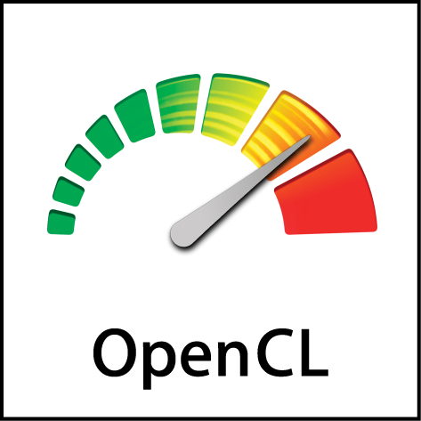

// Copyright 2017-2026 The Khronos Group. This work is licensed under a
// Creative Commons Attribution 4.0 International License; see
// http://creativecommons.org/licenses/by/4.0/

// Extensions to enable
// Must be included before the header and attribs.txt
include::{generated}/specattribs.adoc[]

= The OpenCL^(TM)^ SPIR-V Environment Specification
:R: pass:q,r[^(R)^]
Khronos{R} OpenCL Working Group
:data-uri:
:icons: font
:toc2:
:toclevels: 2
:max-width: 100%
:numbered:
:imagewidth: 800
:fullimagewidth: width="800"
:source-highlighter: rouge
:rouge-style: github
:docinfo: shared-header
:docinfodir: config
:title-logo-image: 
:description: OpenCL(TM) is an open, royalty-free standard for cross-platform \
parallel programming of diverse accelerators. \
This document describes the OpenCL SPIR-V environment.

// Various special / math symbols. This is easier to edit with than Unicode.
include::config/attribs.txt[]

// Attributes that are shared by OpenCL specifications.
include::config/opencl.adoc[]

// Formatting and links for API functions and enums.
include::env/dictionary.adoc[]

include::copyrights.txt[]

<<<

include::env/introduction.adoc[]

include::env/common_properties.adoc[]

include::env/required_capabilities.adoc[]
include::env/validation_rules.adoc[]

include::env/extensions.adoc[]

include::env/numerical_compliance.adoc[]
include::env/image_addressing_and_filtering.adoc[]

include::env/references.adoc[]

:numbered!:
:leveloffset: 1

include::env/appendix_a.adoc[]
